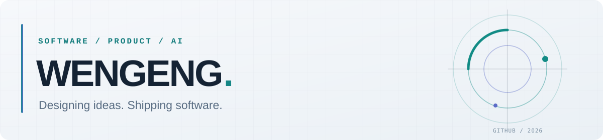

<picture>
  <source media="(prefers-color-scheme: dark)" srcset="./assets/header-dark.svg">
  
</picture>

 

**Developer · Product builder · Student**

[Projects](#selected-work) &nbsp;·&nbsp; [Tech stack](#toolbox) &nbsp;·&nbsp; [Activity](#github-activity)

---

### A little about me

I build practical tools at the intersection of **AI, web development, and developer experience**. I like turning ideas into working products, keeping interfaces simple, and making the details reliable.

- Currently building **Abroa**, a finance experience for international students.
- Exploring **AI infrastructure**, automation, and thoughtful product design.
- Always learning through real projects.

### Selected work

| Project | What it does |
| :--- | :--- |
| **[Pseudocode Editor](https://github.com/WENGENG-boop/PseudocodeEditor)** | Browser-based Cambridge pseudocode editor with execution, trace tables, and syntax assistance. |
| **[Abroa](https://github.com/WENGENG-boop/Abroa)** | Work in progress: adapting personal-finance workflows for international students. |
| **[vibe-usage](https://github.com/WENGENG-boop/vibe-usage)** | Tooling for tracking AI coding usage. |
| **[Personal website](https://github.com/WENGENG-boop/easonweng-site)** | A Next.js personal-site project. |

### Toolbox

### GitHub activity

<picture>
  <source media="(prefers-color-scheme: dark)" srcset="https://github-readme-stats.vercel.app/api?username=WENGENG-boop&show_icons=true&hide_border=true&theme=github_dark&rank_icon=github">
  
</picture>
<picture>
  <source media="(prefers-color-scheme: dark)" srcset="https://github-readme-stats.vercel.app/api/top-langs/?username=WENGENG-boop&layout=compact&hide_border=true&theme=github_dark&langs_count=6">
  
</picture>

  

<picture>
  <source media="(prefers-color-scheme: dark)" srcset="https://raw.githubusercontent.com/WENGENG-boop/WENGENG-boop/output/github-contribution-grid-snake-dark.svg">
  
</picture>

Contribution animation is generated automatically by GitHub Actions.

---

Build useful things. Keep improving them.

